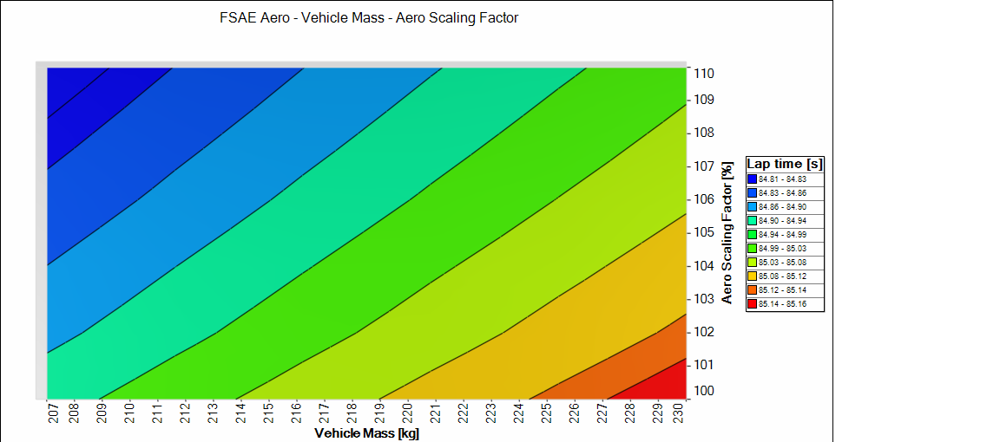
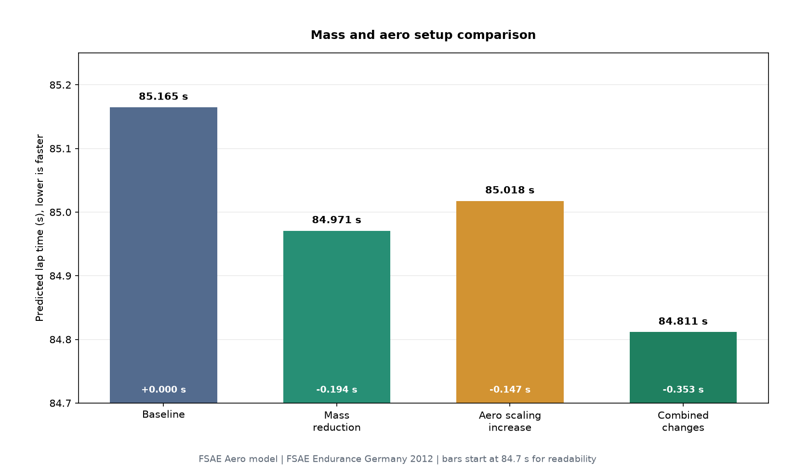

# Mass vs Aero: Lap Time Sensitivity in OptimumLap

## Project question

In the selected OptimumLap vehicle and track model, how does reducing vehicle mass compare with increasing the aero scaling factor, and what happens when both changes are applied?

## Learning outcome

This project practices a basic vehicle-performance workflow: establish a baseline, vary one parameter while holding the other fixed, compare the outputs, then run a combined case. It develops an understanding of sensitivity analysis and of why combined changes should be simulated directly rather than assuming the separate gains add exactly.

The 36-point batch sweep showed lower predicted lap times toward lower vehicle mass and higher aero scaling within the tested ranges. Among the four saved cases, reducing mass from 230 kg to 207 kg at 100% aero improved predicted lap time by 0.194 s. Increasing aero scaling from 100% to 110% at 230 kg improved it by 0.147 s. Applying both produced a 0.353 s improvement over baseline. These are simulator outputs for this model and track.

## Model and data source

- Simulator: OptimumLap
- Vehicle: built-in FSAE Aero model
- Track: built-in FSAE Endurance Germany 2012, closed circuit
- Vehicle mass sweep: 207 to 230 kg in six steps (4.6 kg spacing)
- Aero scaling sweep: 100% to 110% in six steps (2 percentage point spacing)
- Total batch sweep: 36 setup combinations
- Highlighted comparisons: baseline, mass-only, aero-only, and combined cases

The native project and exported results are in this project folder. The sweep table was transcribed from the saved OptimumLap batch export.

## Method

1. Use the 230 kg, 100% aero setup as the baseline.
2. Reduce mass to 207 kg while keeping aero at 100%.
3. Return mass to 230 kg and increase aero scaling to 110%.
4. Apply both changes at 207 kg and 110% aero scaling.
5. Compare predicted lap time and selected summary KPIs for the four runs.
6. Run a 6 by 6 batch sweep across 207 to 230 kg and 100% to 110% aero scaling, with lap time as the plotted output.

## Highlighted results

| Setup | Vehicle mass | Aero scaling | Predicted lap time | Difference vs baseline | Average speed | Top speed | Max lateral acceleration |
|---|---:|---:|---:|---:|---:|---:|---:|
| Baseline | 230 kg | 100% | 85.165 s | +0.000 s | 65.78 km/h | 92.83 km/h | 17.25 m/s² |
| Mass reduction | 207 kg | 100% | 84.971 s | -0.194 s | 65.92 km/h | 92.83 km/h | 17.59 m/s² |
| Aero scaling increase | 230 kg | 110% | 85.018 s | -0.147 s | 65.89 km/h | 92.83 km/h | 17.25 m/s² |
| Combined changes | 207 kg | 110% | 84.811 s | -0.353 s | 66.04 km/h | 92.83 km/h | 17.59 m/s² |

## What the results suggest

The sweep contours and highlighted runs agree on the direction of the response in the tested range: the model predicts faster laps with lower mass and higher aero scaling. The 23 kg mass change had a slightly larger effect than the 10 percentage point aero change in the four highlighted runs. The combined case was fastest at 84.811 s.

The top speed was 92.831 km/h for all four highlighted runs, so the lap-time differences did not come from a change in the reported top-speed ceiling. Average speed increased from 65.776 km/h in the baseline to 66.041 km/h in the combined case. This is consistent with small gains distributed over the lap, but the KPI summary alone does not identify which corners or straights contributed.

The two individual changes sum to about 0.341 s using full-precision outputs, while the combined change is about 0.353 s. That small difference is a model interaction and/or a consequence of how the simulator calculates the combined setup. It is exactly why the combined case is useful.

A useful trade-off comparison is the 207 kg, 100% aero run at 84.971 s versus the 230 kg, 110% aero run at 85.018 s. In this model, the 10 point aero increase nearly offsets the 23 kg mass increase, but the heavier high-aero setup is still about 0.047 s slower.

## Limitations

- This is a simplified lap-time simulation using a generic built-in vehicle and reference track, not measured vehicle data.
- Aero scaling is a model parameter, not a wing geometry, CFD study, wind-tunnel test, or validated aerodynamic package. The result does not establish how a real wing would change both downforce and drag.
- Reducing mass by 23 kg is a hypothetical sensitivity case. The model does not assess design feasibility, cost, safety, or the location of that mass.
- This is one vehicle model and one circuit. Circuit layout and model assumptions can change the relative value of mass and aero.
- The sweep covers only 207 to 230 kg and 100% to 110% aero scaling. It does not prove the same trend outside those ranges.
- Lap time is a simulator output, not an experimental lap-time improvement or performance guarantee.

## Reproduction

1. Open `Lap_Time_Project.OLPro` in OptimumLap.
2. Select the built-in FSAE Aero vehicle and FSAE Endurance Germany 2012 track.
3. Run the four highlighted cases listed above and compare their results in an analysis table.
4. Open the saved 3D batch chart, using Vehicle Mass for X, Aero Scaling Factor for Y, and Lap time for Z.
5. For a fresh batch, use the same six mass values and six aero scaling values recorded in `outputs/tables/mass_aero_sweep.csv`.

## Outputs

- `outputs/tables/setup_comparison.csv`: four saved cases with full-precision lap times and summary KPIs.
- `outputs/tables/mass_aero_sweep.csv`: all 36 combinations from the batch export.
- `outputs/figures/mass_aero_sweep.png`: the chart copied from OptimumLap.
- `outputs/figures/lap_time_by_setup.png`: a comparison chart made from the four saved runs.
- `Lap_Time_Project.OLPro` and `Project/`: native editable simulation project and saved results.
