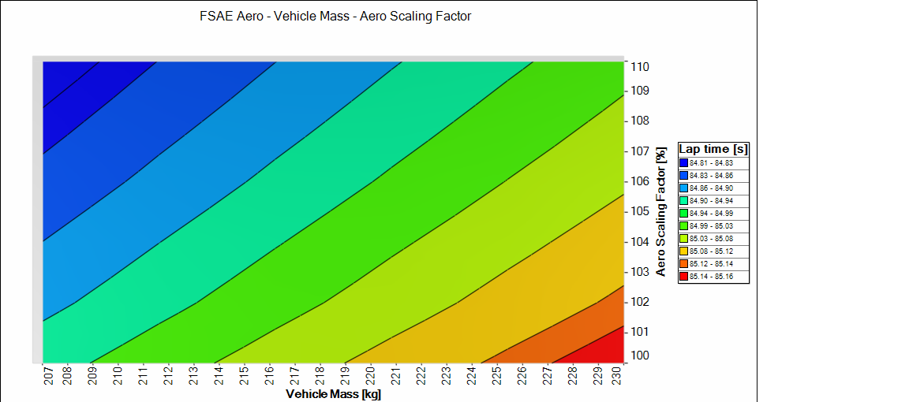
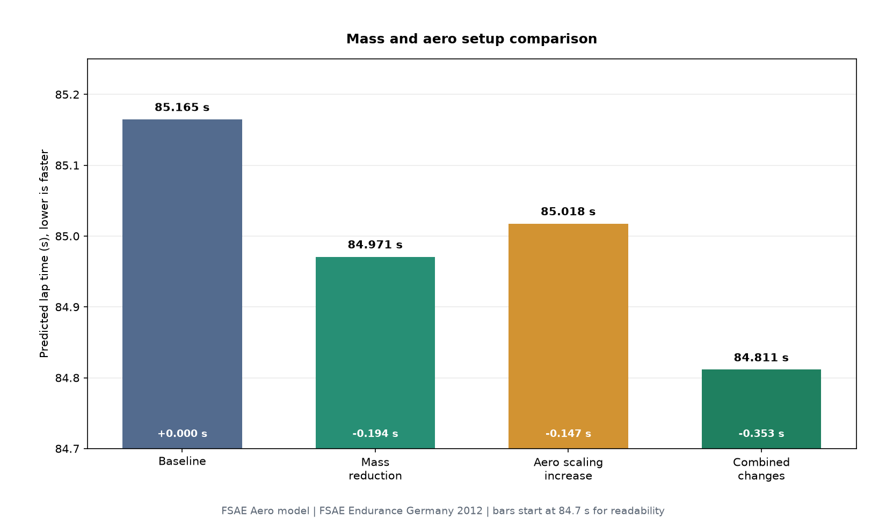

# OptimumLap Vehicle Setup Sensitivity Analysis

A small vehicle-performance study using OptimumLap to compare how vehicle mass and aerodynamic scaling affect simulated lap time on one circuit.

## Project question

For the built-in FSAE Aero vehicle on the FSAE Endurance Germany 2012 track, how does a 10% mass reduction compare with a 10 percentage point increase in aero scaling? What does the model predict when both changes are applied?

## Results at a glance

The baseline uses a vehicle mass of 230 kg and 100% aero scaling. Each highlighted comparison changes one or both of those inputs, with the other model settings held at their saved baseline values.

| Setup | Mass | Aero scaling | Simulated lap time | Change from baseline |
| --- | ---: | ---: | ---: | ---: |
| Baseline | 230 kg | 100% | 85.165 s | 0.000 s |
| Lower mass | 207 kg | 100% | 84.971 s | -0.194 s |
| Higher aero scaling | 230 kg | 110% | 85.018 s | -0.147 s |
| Both changes | 207 kg | 110% | 84.811 s | -0.353 s |

The 36-case batch sweep covers 207 to 230 kg and 100% to 110% aero scaling. Within that tested range, the model predicts lower lap times at lower mass and higher aero scaling. These are OptimumLap outputs for this model and track, not measured vehicle performance.

## What I learned

This project practices a controlled comparison: establish a baseline, vary one parameter at a time, compare the predicted response, then simulate the combined setup. In these four saved cases, the 23 kg mass reduction produced a slightly larger lap-time change than the 10 point aero-scaling increase. The combined result was 0.353 seconds faster than baseline in the simulation.

The result is useful as a sensitivity study. It does not show that a real car would gain the same time from removing 23 kg or fitting a different wing. Aero scaling is an abstract model input, not a tested aerodynamic design.

## Figures

### Lap time across the mass and aero sweep



### Four highlighted setup comparisons



## Method

1. Set the 230 kg, 100% aero setup as the baseline.
2. Simulate 207 kg at 100% aero scaling.
3. Simulate 230 kg at 110% aero scaling.
4. Simulate 207 kg at 110% aero scaling.
5. Compare lap time and selected summary outputs across the four cases.
6. Run a 6 by 6 batch sweep across the saved mass and aero ranges.

## Dataset and software

- **Simulator:** OptimumLap
- **Vehicle model:** OptimumLap built-in FSAE Aero
- **Track model:** OptimumLap built-in FSAE Endurance Germany 2012, closed circuit
- **Data type:** simulation outputs generated by the project, not real-world vehicle telemetry

The vehicle and track are built-in OptimumLap models. This project does not use FastF1, Grand Prix telemetry, tyre test data, CFD, or wind-tunnel measurements.

## Limitations

- The vehicle and track are simplified simulator models, not a measured car and circuit data set.
- Aero scaling is a model parameter. It does not represent a specific wing design or prove how a real aerodynamic package changes downforce and drag.
- The mass reduction is hypothetical. The simulation does not assess how to achieve it, where the mass is removed, or any cost, safety, or design constraints.
- Only one vehicle model and one track are compared. Results may differ on another vehicle, circuit, or set of model assumptions.
- The sweep only covers 207 to 230 kg and 100% to 110% aero scaling. The trend should not be extrapolated outside those ranges.
- Lap time is a simulator prediction. It is not a real-world performance guarantee.

## Repository contents

```text
.
├── README.md
├── PROJECT_REPORT.md
└── outputs
    ├── figures
    │   ├── lap_time_by_setup.png
    │   └── mass_aero_sweep.png
    └── tables
        ├── mass_aero_sweep.csv
        └── setup_comparison.csv
```

The CSV files contain the 36 sweep cases and the four highlighted comparisons. The figures are included so the main results are visible on GitHub without opening OptimumLap.

## Reproducing the comparison

1. Open the project in OptimumLap, if you have access to a compatible version and the native project files are included.
2. Use the built-in FSAE Aero vehicle and FSAE Endurance Germany 2012 track.
3. Run the four highlighted combinations shown in the results table.
4. For the batch comparison, vary vehicle mass from 207 to 230 kg in six steps and aero scaling from 100% to 110% in six steps, with lap time as the output.
5. Compare your exported values with the CSV files in `outputs/tables`.

## Sharing the native OptimumLap files

This repository can be understood from the report, tables, and figures alone. Only add `Lap_Time_Project.OLPro` and the `Project/` files if OptimumLap's license and the source of its built-in vehicle and track models allow redistribution. Otherwise, leave those native files out and use the documented settings to describe how the analysis can be recreated.

## Project report

See [PROJECT_REPORT.md](PROJECT_REPORT.md) for the fuller method, interpretation, limitations, and reproduction notes.
